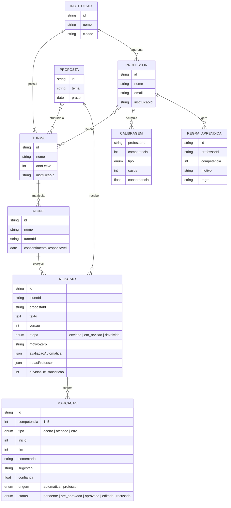

# Modelagem de dados

## Regras principais

| Regra | Onde |
| --- | --- |
| Marcação automática chega pré-aprovada com ≥ 30 casos, ≥ 95% de concordância e confiança ≥ 0,8 | `domain/regras.ts › preAprovada` |
| Aprovar soma 1, editar soma 0,5, recusar soma 0 na concordância | `store/app-store.tsx › decidir` |
| Trecho citado que não existe no texto é descartado | `domain/regras.ts › localizarTrechos` |
| Aluno só vê marcações aprovadas, editadas, pré-aprovadas ou do professor | `domain/regras.ts › visivelParaAluno` |
| Devolver exige zero pendências automáticas | `features/revisao/revisao.tsx` |
| Discrepância com o limite do Inep: 80 por competência, 100 no total | `domain/regras.ts › LIMITE_INEP` |
| Texto com até 7 linhas recebe nota zero | `domain/regras.ts › checagens` |

## Próximos passos de backend

- `POST /api/redacoes` (upload da imagem) → fila de OCR → `ResultadoTranscricao`
- `POST /api/redacoes/:id/correcao` → `ResultadoCorrecao`
- `PATCH /api/marcacoes/:id` (decisão do professor) → atualiza `CALIBRAGEM`
- Multi-tenant por `instituicaoId`, com perfis aluno, professor e coordenação
